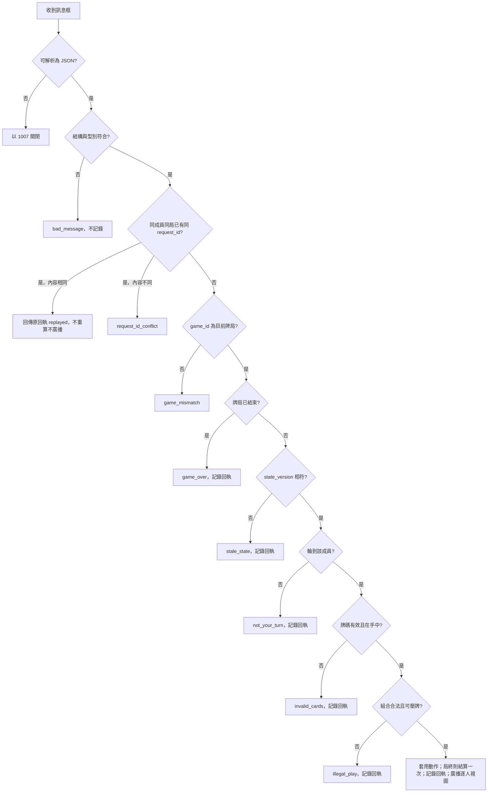

# Phase D 驗收報告：四人大老二私人原型

狀態：**待人工驗收**。本文件記錄審查與測試證據，不代表已核准或已合併。

- 實作提交：`e0865def45d6e743b6f971d86addd25c67100ed9`（基準 `96fb08c31392f8e078a11b681939a180ae234d6a`）
- 規則版本：`taiwan-four-v1`（`backend/app/games/big_two/config.py`）
- 規則來源：已核准的 D1 契約 R01～R13 與定稿補遺（房間、回執、錯誤）。核准紀錄來自對話；
  分支內 `GAME_RULES.md` 只是摘要，完整條款以 D1 為準。
- Draft PR：#6（base `main`）

## 範圍

- 引擎：`backend/app/games/big_two/`（`config.py`、`hands.py`、`engine.py`）。
- 私人原型：`backend/app/prototype/big_two.py`，以 `BIG_TWO_PROTOTYPE_ENABLED=true` 啟用；
  房間、積分與回執只存在記憶體，不寫資料庫。
- 前端：`frontend/src/games/big_two/`、大廳入口。
- 不含：資料庫 migration、正式認證、輪次逾時或自動代打、十三支（Phase E）。

## D1 條款對照

| 條款 | 實作位置 | 測試 |
|---|---|---|
| R01 固定四人與四座位 | `engine._deal`（人數與座位檢查） | `test_deal_and_full_hand`；`test_deal_refuses_wrong_player_sets_and_unknown_rules`（本次新增） |
| R02 點數與花色序 | `config.RANKS`、`config.SUITS`、`card_key` | `test_comparison`；`test_big_two_oracle.py` |
| R03 梅花 3 先出且首組必含 | `engine._deal`（首出者）、`engine._validate`（首組） | `test_deal_and_full_hand`、`test_big_two_prototype.py` |
| R04 合法張數、同點、牌碼互異、須在手中 | `hands.classify`、`engine._validate` | `test_illegal_combinations`、原型錯誤案例 |
| R05 順子表（不含 2） | `config.STRAIGHTS`、`hands.classify` | `test_straights_and_boundaries`、oracle 窮舉 |
| R06～R09 同型比較 | `hands.classify`（比較鍵） | `test_comparison`、oracle 比較 |
| R10 跨型順序、嚴格大於 | `hands.Category`、`Combination.beats` | `test_combinations_and_strength`、oracle |
| R11 PASS 與重置 | `engine._validate`、`engine.apply_action` | `test_pass_reentry_and_reset` |
| R12 結算與名次 | `engine.score` | `test_deal_and_full_hand`、整合測試（經 WebSocket 完賽） |
| R13 斷線保留 | `prototype/big_two.py`（無自動 PASS 或逾時） | 整合測試（中途重連） |
| 房間：單一有效連線、30 分鐘回收、房主關閉 | `Room`、`connect` | `test_offline_expiry_boundary`、`test_online_guest_prevents_recovery_timer_and_owner_can_close` |
| 回執：成敗皆記錄、重播、每席每局 256 筆、保留當前與上一局 | `Room.action`、`Room.start` | `test_finished_receipt_and_fifo`、整合測試 |
| 錯誤邊界：`bad_message`、1007、`invalid_cards` 統一訊息 | `parse_action`、`engine._validate` | `test_four_player_views_and_receipts` |
| 逐人視圖 | `Room.view`、`project_player_view` | 共用引擎契約套件、整合測試（逐人 JSON） |

### 動作處理順序（實作）

## 測試證據

後端測試皆在 `backend/` 以 `requirements-dev.lock` 安裝的環境執行。

| 項目 | 結果 | 來源 |
|---|---|---|
| `e0865def` 的 `pytest` | 741 passed、5 skipped（5 項需要 `TEST_DATABASE_URL`） | 審查者實跑 |
| 本次補強後的 `pytest` | 749 passed、5 skipped（新增 8 項） | 實跑 |
| `ruff check`、`ruff format --check` | 通過 | 實跑 |
| `mypy app tests`（strict，自 `backend/`），基底含 PR #5 的整合樹 | 通過 | 審查者實跑（預演樹） |
| 含 PostgreSQL 的 `746 passed` | 與 5 項 skipped 的 PostgreSQL 測試數相符 | 作者提供，未重跑 |
| 前端單元、型別、lint、build、Playwright | success | CI run 44436966584（`e0865def`）與 PR run 44449313646，未重跑 |

### 本次新增的正式測試

- `backend/tests/test_big_two_integration.py`（3 項，經真實 WebSocket 與隨機牌組）：
  - 逐人 JSON 不含其他成員未出的牌（發牌後、出牌後、每次 PASS 後）。
  - 回合中途（梅花 3 已出、2 次 PASS）重連輪到的成員、已 PASS 的成員與出牌者，
    `turn`、`target`、`passes`、`state_version`、張數、已出牌與手牌皆與斷線前一致。
  - 以只出單張的策略打完整局：結算為零和、勝者所得等於輸家扣分合計；重送致勝請求回傳原回執
    且不增加積分；同局以新 request_id 回 `game_over`；房主開下一局取得新 `game_id`，
    累計積分保留。
- `backend/tests/games/test_big_two.py` 新增 1 項：人數不是四、座位或玩家 ID 重複皆回 `invalid_players`，
  規則版本不符回 `rules_mismatch`（先前 repo 內沒有這類拒絕案例的測試）。
- `backend/tests/games/test_big_two_oracle.py`（4 項）：依 D1 R02～R10 另寫的獨立 oracle，
  與 `classify`、`Combination.beats` 比對：
  - 1～3 張全部組合；
  - 全部順子與同花順（含 8,160 順子、32 同花順的數量）、全部同花（5,116）、全部葫蘆
    （3,744）、全部鐵支（624）；
  - 20,000 組固定種子的隨機五張；
  - 30,000 組固定種子的同張數比較。
- 變異檢查（在暫存副本上，非 repo 內容）：視圖加入其他成員手牌、積分重複入帳、視圖的
  `passes` 恆為 0，三者都被整合測試抓到；把同花比較改成先比花色，被 oracle 比較測試抓到。

一次性的全量執行（全部 2,598,960 手五張牌，另加 300,000 組隨機比較）0 筆不一致，其數量為
鐵支 624、葫蘆 3,744、同花順 32、順子 8,160、同花 5,116。因執行時間較長，未納入常規測試。

## 審查結論

唯讀審查（審查者：Claude）對照 D1 R01～R13 與補遺，未發現阻擋缺陷，建議通過；此為審查結論，
不是人工核准。

## 已知限制與未驗證項目

- CI 的 mypy 自 repo 根目錄執行 `mypy backend/app backend/tests`，該位置不會讀取
  `backend/pyproject.toml` 的 strict 設定；strict 通過是在 `backend/` 內本機驗證。
  CI 尚未改為 strict。
- 前端「離開頁面或房間視同離線」的行為，審查者只讀過程式碼，未重跑 Playwright。
- 全員離線 30 分鐘的回收與逐人帳本只存在記憶體；程序重啟後全部消失（與 D1 一致）。
- 斷線沒有逾時機制：牌局會停在斷線者的回合（與 D1 R13 一致）。
- 整合測試使用隨機牌組並以固定策略驅動，不是固定牌序的完整牌局；固定牌序的結算由
  `test_finished_receipt_and_fifo` 與 `test_deal_and_full_hand` 涵蓋。
- `TASKS.md` 的 P4-01～P4-04 沿用「2～4 人」的舊描述，未勾選；D1 已改為固定四人，
  是否改寫或取代這四項需人工決定。
